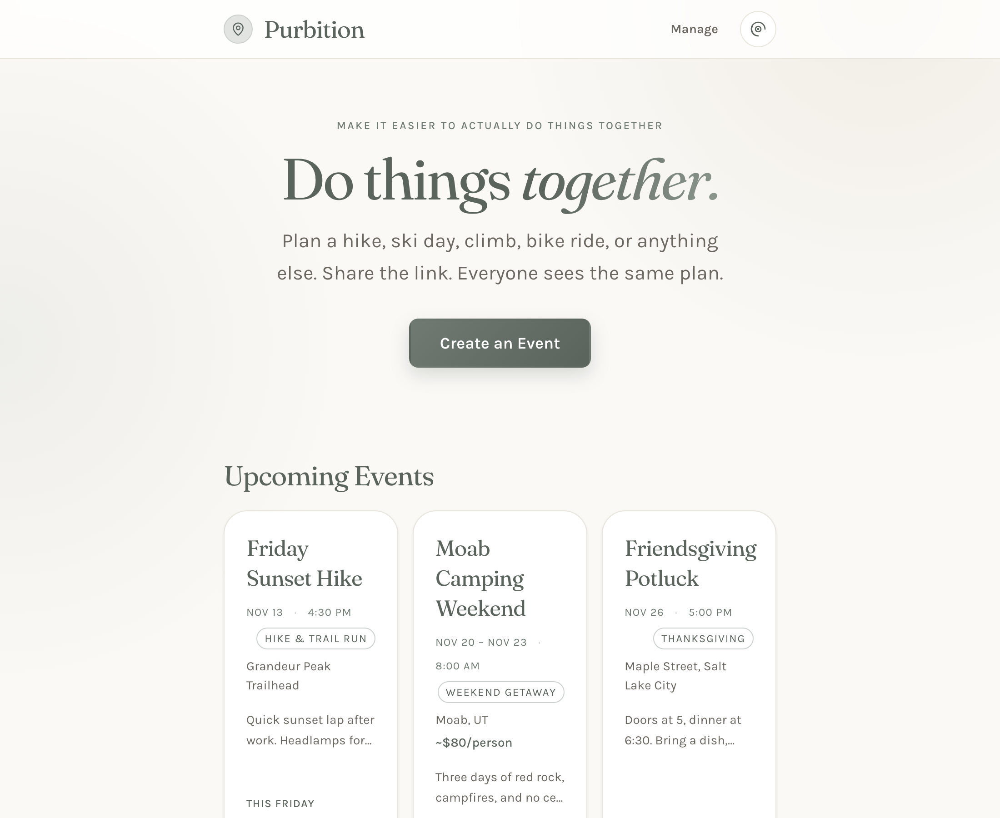
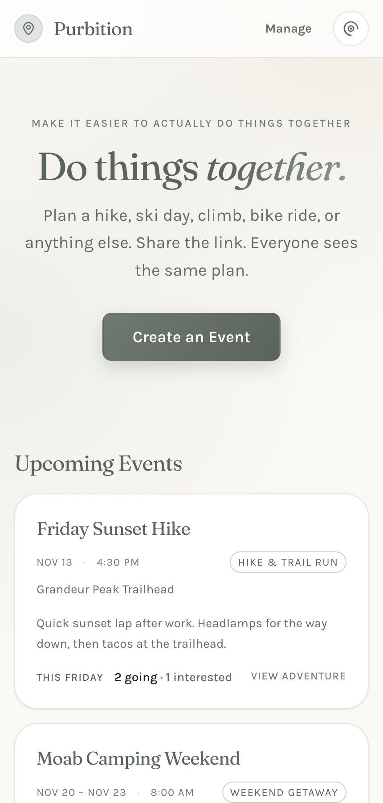
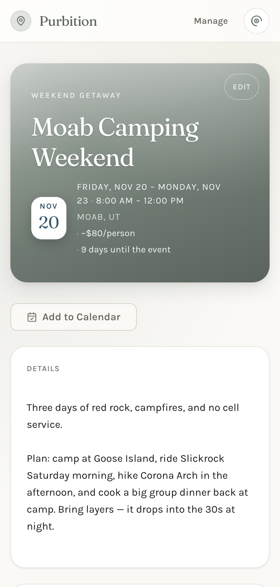
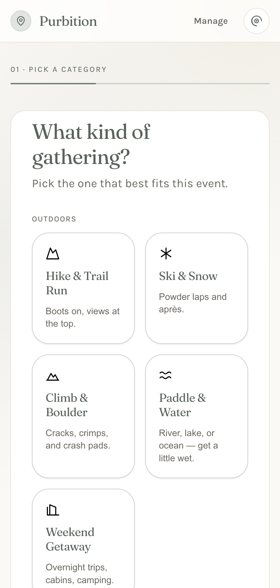
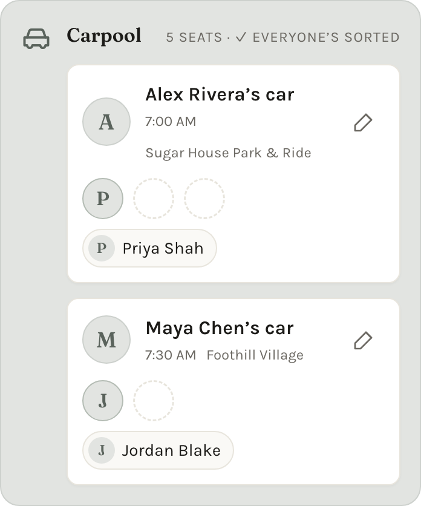
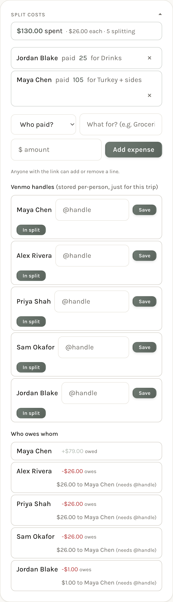
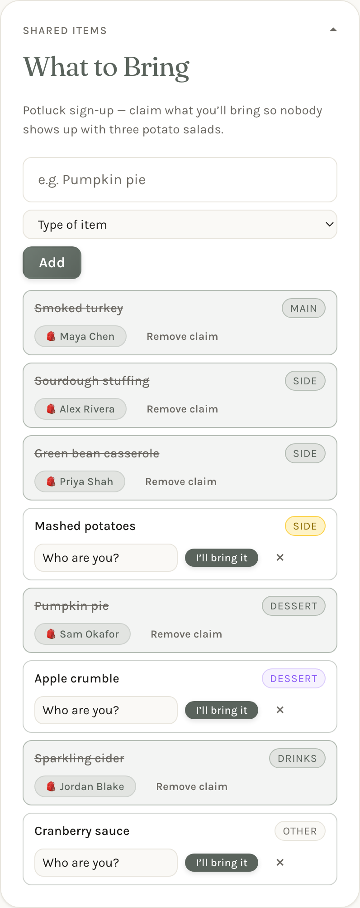
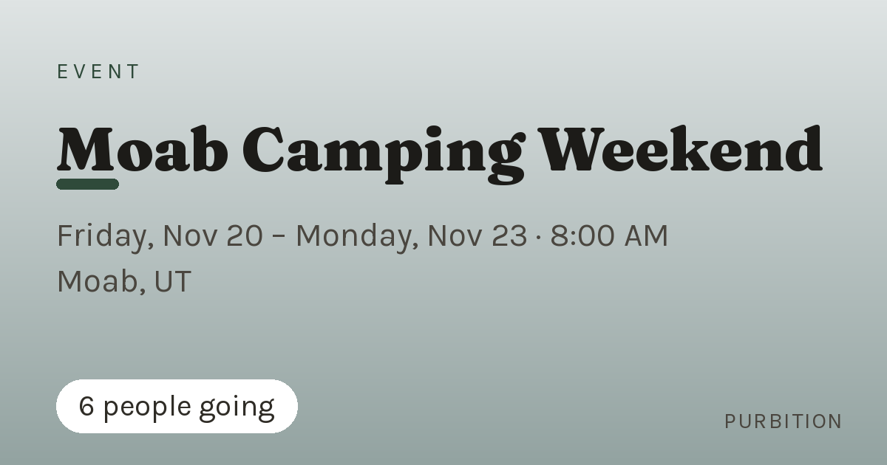

# Purbition

**Make it easier for people to actually do things together.**

Purbition turns a plan buried in a group chat into **one link**. Create an event,
drop the link in the chat, and everyone sees the same page: who's going, who's
driving, what to bring, what it costs, and what the weather looks like.

No accounts, no app to install, no group-chat archaeology.

**Live:** [purbition.com](https://purbition.com)

<p align="center">
  
</p>

<p align="center">
  
  
  
</p>

## Why I built it

I kept organizing hikes, ski days, and weekend trips the same way: post the idea
in a group chat, answer the same questions six times, lose track of who's
actually coming, and screenshot the plan so people could find it later.

Purbition is the page that replaces that thread. Someone creates the event once,
shares the link, and the page stays current — including the details that usually
get re-asked ("who's driving?", "how much?", "is it going to rain?") and the ones
that get lost (who's bringing the turkey).

The goal was never to build a social network. It was to make **one real plan with
twenty friends** go smoothly, and to keep the stack boring enough that I could
understand and maintain every line of it.

## What it does

**Events**
- Three-step create wizard: category → details → review
- Optional cover image, tagline, description, and a vibe-based color theme
- Recurring series (weekly / biweekly / monthly) with "edit all future" and "cancel all future"
- Soft delete with a 24-hour undo window
- Any event can be edited by anyone with the link — no accounts by design

**RSVP**
- Going / Interested / Can't Go
- Optional **+1 guest** with their name
- Re-clicking your current status updates your RSVP instead of duplicating it
- A per-browser token cookie remembers you, so returning visitors change their
  status with one tap
- Duplicate names are disambiguated automatically (`Sam ·2`, `Sam ·3`)

**Carpool** — opt-in per event
- Drivers post seats, departure time, and pickup spot
- Riders claim a seat; the card shows when everyone is sorted
- Editing and reassigning are open to anyone with the link

**Money** — opt-in per event
- Free-text per-person cost estimate (`~$80/person`)
- Itemized cost breakdown with a running total
- Equal split math with a running net per person
- Venmo handles + one-tap payment deeplinks

**Potluck / group gear** — opt-in per event
- Anyone can add an item and claim what they'll bring
- Claimed items show who has them; unclaimed items get a one-tap claim
- If the browser has no RSVP cookie, a "Who are you?" picker lets people claim
  without re-RSVPing
- Items sort by course (main → side → appetizer → dessert → drinks) and duplicate
  labels increment a quantity instead of creating a second row

**Weather** — opt-in per event
- Open-Meteo forecast, 6-hour cache, multi-day strip for trips
- Fails soft: no forecast means no card, never a broken page

**Sharing**
- A generated 1200×630 OG card so the link unfurls nicely in iMessage, WhatsApp,
  and Discord
- One-tap `.ics` download that works with Apple Calendar, Google Calendar, and Outlook
- A manage page listing every event with a copy-link button:
  `/manage`

**Appearance**
- 12 color palettes, light and dark modes, system preference respected

<p align="center">
  
  
  
</p>

<p align="center">
  
</p>

## The interesting engineering bits

**No accounts, without losing identity.** Everything is link-trusted: anyone with
the link can RSVP, claim a car seat, or edit the plan. To let a returning visitor
change *their own* RSVP, the server issues an opaque token in an HttpOnly cookie
when they first RSVP. Re-clicking a status updates that row in place — it never
creates a duplicate and never deletes the person's +1 by accident. When the
cookie is missing (different device, in-app browser, cleared storage), the UI
degrades to "pick yourself from the list" instead of blocking the action.

**Server-rendered fragments.** Carpool, costs, splits, and the potluck board all
mutate over `fetch()` — but the JavaScript never rebuilds markup. Each action
route re-renders the same Jinja partial the initial page used and returns the
HTML, which the browser swaps in. One source of truth per card means the
server-rendered and JS-updated versions can't drift.

**Fast reads, honest tradeoffs.** Production runs SQLite on Turso. Railway keeps
an embedded replica on local disk, so reads are sub-millisecond, while writes go
to the primary. The tradeoff: a direct write to the primary doesn't appear in the
replica until the service restarts. That's documented in the repo's working notes
rather than papered over.

**Undo instead of confirmation dialogs.** Deleting an event is a soft delete with
a 24-hour window and a dedicated deleted-state page, so a mis-tap costs a click
instead of a plan.

**Generated share images.** `share_card.py` composes the OG preview at request
time with Pillow: a vibe-tinted gradient, auto-shrinking type that fits long event
names, and a "N people going" chip. No design tool, no static assets per event.

**Small accessibility budget, enforced.** WCAG AA contrast on text tokens, 44px
touch targets, visible focus rings, `aria-expanded` on collapsible cards, and
keyboard support (Enter submits, Escape closes popups).

## Stack

| Layer | Choice | Why |
| --- | --- | --- |
| Backend | Python 3, Flask, Jinja | Server-rendered pages, no API layer to maintain |
| Frontend | Vanilla HTML/CSS/JS | No build step, no framework, readable in one sitting |
| Database | SQLite (dev) / Turso (prod) | SQLite semantics with a hosted, replicated production DB |
| Weather | Open-Meteo | No API key, generous free tier |
| Share images | Pillow | Generated on demand |
| Hosting | Railway + Cloudflare | Push-to-deploy, custom domain, TLS |

About 9,000 lines across the app, templates, styles, and dev tooling — with no build step and no frontend dependencies.

## Run it locally

```bash
git clone https://github.com/EricMcLo/purbition.git
cd purbition
python3 -m venv venv
source venv/bin/activate
pip install -r requirements.txt
python app.py
```

Open <http://localhost:8080>. With no environment variables set, the app creates
and uses a local `database.db` — no external services, no cost, nothing to sign up
for.

To point it at a hosted Turso database instead:

```bash
cp .env.example .env
# fill in TURSO_DATABASE_URL and TURSO_AUTH_TOKEN
set -a; . ./.env; set +a
python app.py
```

## Project layout

```
app.py                 Flask app, routes, view helpers
models/
  core.py              DB connection, schema, Turso/local switching
  adventures.py        events + recurring series
  attendees.py         RSVPs, carpool state machine
  costs.py             cost items, expenses, split math
  packing.py           potluck / group-gear board
templates/             Jinja pages and partials
static/
  style.css            layout, components, themes
  palettes.css         12 color palettes
  app.js               progressive enhancement (no framework)
weather.py             Open-Meteo fetch + geocoding
share_card.py          dynamic OG share-card generator (Pillow)
bin/                   dev tooling: screenshots, phone audit, smoke test
```

## Notes and limitations

- **No authentication, by design.** The security model is "anyone with the link."
  That is a deliberate product choice for a small friend group, not an oversight.
- **Single-instance production.** The embedded Turso replica assumes one Railway
  service; scaling horizontally would need a different read strategy.
- **No automated test suite yet.** I verify with route-level smoke checks,
  headless-browser screenshots at real phone widths (`bin/phone_audit.py`), and a
  production health check (`bin/smoke.sh`).
- All screenshots use invented people and events.

## License

MIT — see [LICENSE](LICENSE).
